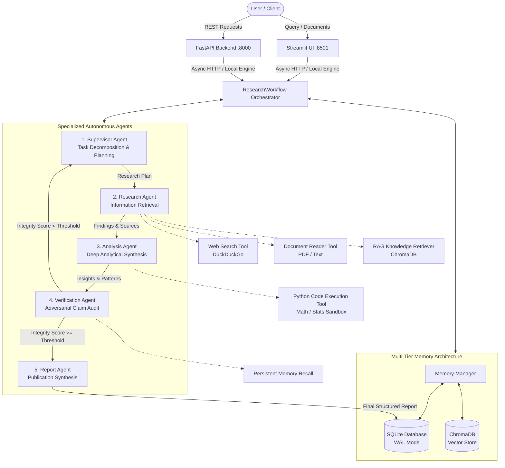

# Autonomous Multi-Agent AI Research & Analysis Assistant

[](https://www.python.org/)
[](https://github.com/openai/openai-agents-python)
[](https://fastapi.tiangolo.com/)
[](https://streamlit.io/)
[](https://www.trychroma.com/)
[](LICENSE)

An enterprise-ready, hierarchical multi-agent research and analysis intelligence platform built on the **OpenAI Agents SDK**. The system orchestrates five specialized autonomous agents with structured data contracts, integrated tool calling, Retrieval-Augmented Generation (RAG), multi-tier persistent memory, an automated quality gate verification loop, a high-throughput FastAPI backend, and an interactive Streamlit research studio.

---

## 🏛️ System Architecture



---

## 🤖 The 5 Specialized Agents

Each agent is configured with distinct system instructions, concrete Pydantic schemas, and specialized tool bindings:

| Agent | Core Role | Structured Input / Output Contract | Tool Bindings |
| :--- | :--- | :--- | :--- |
| **1. Supervisor Agent** | Query classification, objective formulation, and task delegation. | `user_query` &rarr; `ResearchPlan` | None (pure reasoning orchestrator) |
| **2. Research Agent** | Factual investigation, literature discovery, and citation gathering. | `ResearchPlan` &rarr; `ResearchOutput` | `web_search`, `read_document`, `retrieve_knowledge`, `save_memory_fact`, `recall_memory_facts` |
| **3. Analysis Agent** | Trend pattern recognition, strategic opportunities, and comparative trade-offs. | `ResearchOutput` &rarr; `AnalysisOutput` | `execute_python_code` (sandboxed math/stats engine) |
| **4. Verification Agent** | Adversarial fact-checking, contradiction detection, and integrity rating ($0.0 - 1.0$). | `ResearchOutput` + `AnalysisOutput` &rarr; `VerificationOutput` | `recall_memory_facts` |
| **5. Report Agent** | Synthesis into executive briefs, thematic sections, key takeaways, and formal references. | Audited Pipeline Data &rarr; `ReportOutput` | None (synthesis & database persistence) |

---

## ✨ Key Features

- **Hierarchical Multi-Agent Orchestration**: Dynamic task delegation using the OpenAI Agents SDK with strict Pydantic data contracts across agent handoffs.
- **Automated Verification Quality Gate**: Adversarial audit loop that classifies claims into `VERIFIED`, `UNSUPPORTED`, or `CONTRADICTORY`. If integrity falls below a configurable threshold (e.g., $0.70$), revision iterations are automatically triggered.
- **Multi-Tier Memory Architecture**:
  - *Short-Term Memory*: Ephemeral in-memory scratchpads across workflow stages.
  - *Conversational Windowing*: Context-aware multi-turn message history with token sliding windows.
  - *Long-Term Persistent Memory*: Structured SQLite database in Write-Ahead Logging (WAL) mode storing facts, audit traces, and synthesized reports.
- **Retrieval-Augmented Generation (RAG)**: ChromaDB vector store integration with deterministic semantic embeddings, chunking strategies, and automated document ingestion (Text, Markdown, PDF).
- **Dual Interface**:
  - **FastAPI Backend (`:8000`)**: Asynchronous endpoints, background tasks, OpenAPI/Swagger docs, CORS, and streaming status polling.
  - **Streamlit Frontend (`:8501`)**: Real-time research studio, interactive chat, RAG knowledge manager, and SQLite session history inspector.
- **Enterprise Evaluation Suite**: Benchmark harness measuring stage latencies, token consumption modeling, structural schema completeness, claim classification ratios, and citation density.
- **Production Containerization**: Multi-stage Dockerfile and Docker Compose configuration with non-root security and persistent volumes.

---

## 🚀 Quickstart Guide

### 1. Prerequisites
- Python 3.12+
- Git
- OpenAI API Key (optional: system automatically falls back to an offline simulated runner if no key is provided).

### 2. Installation
```bash
# Clone the repository
git clone https://github.com/your-username/multi-agent-ai-system.git
cd "multi-agent-ai-system"

# Create and activate a Python 3.12 virtual environment
python -m venv .venv
# On Windows:
.\.venv\Scriptsctivate
# On Linux/macOS:
source .venv/bin/activate

# Install dependencies
pip install -r requirements.txt
```

### 3. Environment Setup
```bash
# Copy the template configuration
cp .env.example .env

# Edit .env with your OpenAI credentials
# OPENAI_API_KEY=sk-...
```

---

## 🖥️ Running the Application

### Option A: Local Development

#### Start the FastAPI Backend:
```bash
uvicorn src.api.main:app --host 0.0.0.0 --port 8000 --reload
```
Interactive Swagger documentation will be available at: [http://localhost:8000/docs](http://localhost:8000/docs)

#### Start the Streamlit Frontend:
```bash
streamlit run src/frontend/app.py --server.port 8501
```
The research dashboard will open at: [http://localhost:8501](http://localhost:8501)

---

### Option B: Docker Compose (One-Command Deployment)

Deploy both the backend API and frontend dashboard in isolated containers:
```bash
docker compose up --build
```

- **FastAPI Backend**: [http://localhost:8000](http://localhost:8000)
- **Streamlit Frontend**: [http://localhost:8501](http://localhost:8501)
- **Shared Data Volume**: Automatically maps SQLite memory and ChromaDB vector store into `/app/data`.

To stop the services:
```bash
docker compose down
```

---

## 📡 REST API Reference

| Method | Endpoint | Description |
| :--- | :--- | :--- |
| `GET` | `/health` | Service health status. |
| `POST` | `/api/research` | Submit research topic (synchronous or background async). |
| `GET` | `/api/research/{session_id}` | Poll background execution status, logs, and report. |
| `GET` | `/api/sessions` | List all historical research sessions with summaries. |
| `GET` | `/api/sessions/{session_id}/messages` | Retrieve full multi-agent conversational audit trail. |
| `GET` | `/api/sessions/{session_id}/memories` | Retrieve persistent facts recorded by agents. |
| `POST` | `/api/rag/ingest` | Ingest external text or markdown into ChromaDB vector store. |
| `POST` | `/api/rag/query` | Perform semantic vector similarity search. |

### Example: Triggering a Research Workflow
```bash
curl -X POST "http://localhost:8000/api/research" \
     -H "Content-Type: application/json" \
     -d '{
       "topic": "Solid State Battery Electrolytes for Commercial EV Applications",
       "run_async": false,
       "verification_threshold": 0.75
     }'
```

---

## 🧪 Testing & Evaluation

### Run Complete Test Battery (60+ Unit & Integration Tests):
```bash
pytest -v tests/
```

### Run Multi-Domain Evaluation Benchmark Suite:
```bash
python main_phase9_test.py
```
This benchmarks latency distributions, schema completeness, claim classification ratios, and citation density across multiple real-world research topics.

---

## 📂 Project Structure

```text
├── Dockerfile                      # Production container image definition
├── docker-compose.yml              # Multi-container orchestration (API + UI)
├── requirements.txt                # Production dependency specification
├── .env.example                    # Environment configuration template
├── .dockerignore                   # Docker build exclusions
├── .gitignore                      # Git repository exclusions
├── README.md                       # Architectural and operational documentation
├── data/                           # Local persistent storage
│   ├── chroma/                     # ChromaDB persistent vector database
│   └── research_memory.db          # SQLite relational database (WAL mode)
├── src/
│   ├── agents/                     # Specialized autonomous agent definitions
│   │   ├── schemas.py              # Pydantic data contracts (Plan, Findings, etc.)
│   │   ├── supervisor.py           # Supervisor Agent & task decomposition
│   │   ├── research_agent.py       # Research Agent & information gathering
│   │   ├── analysis_agent.py       # Analysis Agent & pattern discovery
│   │   ├── verification_agent.py   # Verification Agent & adversarial audit
│   │   └── report_agent.py         # Report Agent & publication assembly
│   ├── api/                        # FastAPI REST service
│   │   ├── main.py                 # FastAPI application routes & middleware
│   │   └── schemas.py              # API request & response schemas
│   ├── database/                   # Relational & persistent memory
│   │   ├── db.py                   # SQLite DatabaseManager with WAL mode
│   │   ├── memory.py               # MemoryManager (Scratchpad, History, Facts)
│   │   └── models.py               # Pydantic storage schemas
│   ├── evaluation/                 # Testing & evaluation benchmarking framework
│   │   └── evaluator.py            # Latency profiling, token modeling, schema auditing
│   ├── frontend/                   # Streamlit interactive dashboard
│   │   └── app.py                  # Multi-view Research Studio UI
│   ├── rag/                        # Retrieval-Augmented Generation
│   │   ├── embeddings.py           # Embedding generation pipeline
│   │   ├── retriever.py            # KnowledgeRetriever interface
│   │   └── vector_store.py         # ChromaDB client wrapper
│   ├── tools/                      # Agent tool definitions
│   │   ├── document_reader.py      # PDF & text ingestion tool
│   │   ├── python_tool.py          # Sandboxed code execution tool
│   │   └── web_search.py           # Web search tool (DuckDuckGo)
│   └── workflows/                  # Multi-agent orchestrators
│       └── research_workflow.py    # Hierarchical ResearchWorkflow with Quality Gate
└── tests/                          # Automated test suites
    ├── test_phase1.py              # Agent creation tests
    ├── test_phase2.py              # Structured output tests
    ├── test_phase3.py              # Workflow orchestration tests
    ├── test_phase4.py              # Tool calling tests
    ├── test_phase5.py              # RAG & ChromaDB tests
    ├── test_phase6.py              # Memory & SQLite tests
    ├── test_phase7.py              # FastAPI endpoint tests
    ├── test_phase8.py              # Streamlit UI tests
    ├── test_phase9.py              # Evaluation & benchmarking tests
    └── test_phase10.py             # Deployment & configuration tests
```

---

## 📜 License
This project is licensed under the MIT License. See [LICENSE](LICENSE) for details.
