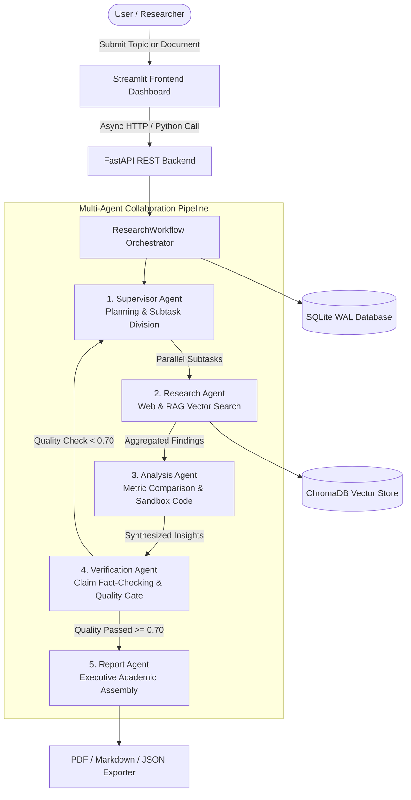
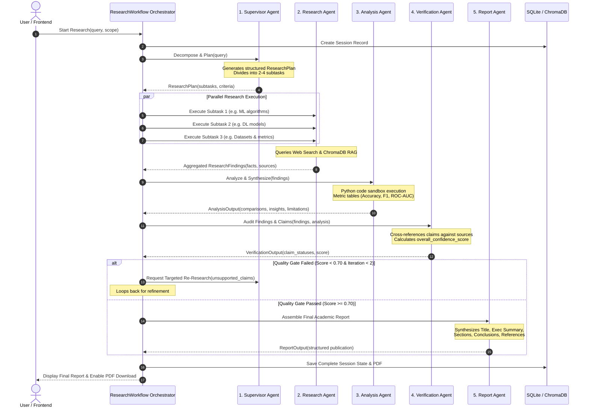

# 📘 Multi-Agent AI Research & Analysis Assistant
## Complete Engineering Architecture & Page-by-Page Workflow Guide

---

## 📌 ১. ওভারভিউ এবং সিস্টেম আর্কিটেকচার (System Architecture Overview)

এই প্রজেক্টটি একটি **Autonomous Multi-Agent AI Research & Analysis System**। এটি একক কোনো এলএলএম প্রম্পটের ওপর নির্ভরশীল নয়; বরং **OpenAI Agents SDK** আর্কিটেকচার ও **Pydantic** ডেটা ভ্যালিডেশন ব্যবহার করে ৫টি বিশেষায়িত (Specialized) এআই এজেন্টের মাধ্যমে একটি একাডেমিক ও ইন্ডাস্ট্রি-গ্রেড গবেষণা স্বয়ংক্রিয়ভাবে সম্পন্ন করে।

### 🛠️ প্রযুক্তি স্ট্যাক (Technology Stack)
- **Core Orchestration:** Python 3.12, Asyncio, OpenAI Agents SDK / OpenAI API
- **Data Validation & Schemas:** Pydantic v2
- **Agent Roles:** Supervisor, Research, Analysis, Verification, Report
- **Tools:** DuckDuckGo / Custom Web Search, PyPDF Reader, Python Sandbox Code Runner, ReportLab PDF Exporter
- **RAG Pipeline:** ChromaDB Vector Database, Sentence-Transformers / OpenAI Embeddings
- **Storage & Memory:** SQLite (WAL Mode enabled) for persistent research sessions and multi-tier memory
- **API Backend:** FastAPI, Uvicorn, Asynchronous REST Endpoints
- **Frontend UI:** Streamlit (Multi-view interactive reactive dashboard)
- **Evaluation:** Precision/Recall latency profiling, token estimation, benchmark suites



---

## 🖥️ ২. পেজ-বাই-পেজ ইউজার ইন্টারফেস ও ওয়ার্কফ্লো (Page-by-Page UI Workflow)

Streamlit ফ্রন্টএন্ড ড্যাশবোর্ডে **৫টি মূল পেজ বা ভিউ (Views)** রয়েছে। ব্যবহারকারী সাইডবারের **Navigation** থেকে এগুলো পরিবর্তন করতে পারেন।

---

### 🔬 ভিউ ১: Research Studio (প্রধান গবেষণা ওয়ার্কস্পেস)

#### উদ্দেশ্য (Purpose):
ব্যবহারকারী এখান থেকে নতুন রিসার্চ শুরু করেন, লাইভ এজেন্ট কোলাবরেশন দেখেন এবং চূড়ান্ত রিপোর্ট ডাউনলোড করেন।

#### পেজের উপাদানসমূহ (UI Components):
1. **Research Topic Input & Presets:**
   - একটি টেক্সট এরিয়া যেখানে গবেষক তার গবেষণার প্রশ্ন টাইপ করেন।
   - উপরের ড্রপডাউনে রেডিমেড প্রিসেট রয়েছে (যেমন: *Heart Disease Detection ML/DL*, *Quantum Computing Cryptography*, ইত্যাদি)।
2. **Specialized Agent Team Pipeline (Status Cards):**
   - স্ক্রিনের মাঝে ৫টি এজেন্টের কার্ড রয়েছে: **Supervisor**, **Research**, **Analysis**, **Verification**, **Report**।
   - কাজ শুরুর আগে এগুলো `Ready` থাকে। কাজ চলাকালীন `Active` এবং শেষ হলে `Completed` স্ট্যাটাসে রূপান্তরিত হয়।
3. **Execution Timeline & Logs:**
   - প্রতিটি এজেন্টের কাজের সময় এবং অভ্যন্তরীণ চিন্তা (Thinking/Reasoning logs) এক্সপ্যান্ডার আকারে দেখা যায়।
4. **Structured Research Output Tabs:**
   - **📑 Executive Report:** চূড়ান্ত একাডেমিক রিপোর্ট (টাইটেল, সামারি, সেকশনসমূহ, কনক্লুশন)।
   - **🔬 Verified Findings:** প্রতিটি দাবির সোর্স URL এবং এভিডেন্স।
   - **📊 Comparative Analysis:** অ্যালগরিদমসমূহের তুলনামূলক টেবিল (Accuracy, F1-score, ROC-AUC, Dataset)।
   - **🛡️ Fact-Check Audit:** অডিট স্ট্যাটাস (`Verified`, `Partially Verified`, `Unsupported`, `Contradicted`) এবং কনফিডেন্স স্কোর।
5. **Export Buttons:**
   - **Download PDF Report:** ReportLab দিয়ে জেনারেট করা হাই-কোয়ালিটি প্রিন্টেবল পিডিএফ।
   - **Download Markdown:** সরাসরি গিটহাব বা ব্লগে প্রকাশের উপযোগী `.md` ফাইল।
   - **Download Raw JSON:** অন্য সফটওয়্যারে ব্যবহারের জন্য পূর্ণাঙ্গ স্ট্রাকচার্ড ডেটা।

#### ব্যাকএন্ড ওয়ার্কফ্লো (Backend Action):
ব্যবহারকারী **"🚀 Start Multi-Agent Research"** বাটনে ক্লিক করলে:
1. `ResearchWorkflow.run(topic, research_scope)` মেথড কল হয়।
2. ডেটাবেজে নতুন একটি `ResearchSession` তৈরি হয়।
3. সুপারভাইজার থেকে শুরু করে ৫টি এজেন্টের পাইপলাইন ধারাবাহিকভাবে চালু হয়।

---

### 💬 ভিউ ২: Interactive Chat (ইন্টারেক্টিভ এআই চ্যাট)

#### উদ্দেশ্য (Purpose):
সম্পন্ন হওয়া রিসার্চ বা সংগৃহীত নলেজ বেজ নিয়ে গবেষকের যেকোনো ফলো-আপ প্রশ্নের উত্তর দেওয়া।

#### পেজের উপাদানসমূহ (UI Components):
1. **Chat Window:**
   - চ্যাট হিস্ট্রি ডিসপ্লে (ইউজার মেসেজ এবং অ্যাসিস্ট্যান্ট রেসপন্স)।
2. **Context Grounding Indicator:**
   - বর্তমানে সক্রিয় রিসার্চ রিপোর্ট এবং আপলোডকৃত ডকুমেন্টের রেফারেন্স স্ট্যাটাস।
3. **Message Input:**
   - প্রম্পট লেখার বক্স যেখানে ইউজার স্পেসিফিক প্রশ্ন করতে পারেন (যেমন: "Which algorithm had the lowest false-negative rate?").

#### ব্যাকএন্ড ওয়ার্কফ্লো (Backend Action):
1. ইউজারের প্রশ্নটি মেমরিতে থাকা `ReportOutput` এবং ChromaDB ভেক্টর ডেটাবেজে সার্চ করা হয়।
2. প্রাসঙ্গিক অংশগুলো রিট্রিভ করে এলএলএম প্রম্পটে কনটেক্সট হিসেবে দেওয়া হয়।
3. তথ্যনির্ভর ও রেফারেন্সসহ উত্তর তৈরি করে স্ক্রিনে প্রদর্শন করা হয়।

---

### 📚 ভিউ ৩: RAG Knowledge Base (ডকুমেন্ট ইনজেশন ও ভেক্টর স্টোর)

#### উদ্দেশ্য (Purpose):
ব্যবহারকারীর নিজস্ব অফলাইন PDF রিসার্চ পেপার, কনফারেন্স পেপার বা টেক্সট ফাইল আপলোড করে নিজস্ব নলেজ বেজ তৈরি করা।

#### পেজের উপাদানসমূহ (UI Components):
1. **Document Uploader:**
   - Drag-and-drop ফাইল আপলোডার (সাপোর্ট করে: `.pdf`, `.txt`, `.md`)।
2. **Chunking & Ingestion Settings:**
   - চাঙ্ক সাইজ (ডিফল্ট: 500 ক্যারেক্টার) এবং ওভারল্যাপ কনফিগারেশন।
3. **Active Knowledge Base Table:**
   - বর্তমানে স্টোর করা ফাইলসমূহ, মোট চাঙ্ক সংখ্যা এবং আপলোড টাইমস্ট্যাম্পের তালিকা।
4. **Vector Search Tester:**
   - ব্যবহারকারী কোনো কি-ওয়ার্ড লিখে টেস্ট করতে পারেন যে ভেক্টর স্টোর থেকে সঠিক চাঙ্ক রিট্রিভ হচ্ছে কিনা।

#### ব্যাকএন্ড ওয়ার্কফ্লো (Backend Action):
1. `PyPDF` বা ফাইল রিডারের মাধ্যমে টেক্সট এক্সট্রাক্ট করা হয়।
2. `RecursiveCharacterTextSplitter` দিয়ে টেক্সটকে ছোট ছোট চাঙ্কে ভাগ করা হয়।
3. `EmbeddingEngine` এর মাধ্যমে প্রতিটি চাঙ্কের জন্য ভেক্টর এম্বেডিং তৈরি করা হয়।
4. এম্বেডিং এবং মেটাডেটা (ফাইলের নাম, পেজ নাম্বার) **ChromaDB**-তে পারসিস্টেন্টলি সেভ করা হয়।

---

### 🕒 ভিউ ৪: Session History (পূর্ববর্তী গবেষণার আর্কাইভ)

#### উদ্দেশ্য (Purpose):
অতীতে সম্পন্ন করা সমস্ত রিসার্চ সেশন ট্র্যাক করা, পুনরায় লোড করা বা মুছে ফেলা।

#### পেজের উপাদানসমূহ (UI Components):
1. **Research Sessions Table:**
   - সেশন আইডি, রিসার্চের টপিক, তৈরির তারিখ, স্ট্যাটাস (`COMPLETED`, `FAILED`), এবং কোয়ালিটি স্কোর।
2. **Session Detail Viewer:**
   - যেকোনো সেশন সিলেক্ট করলে তার পুরো এক্সিকিউটিভ রিপোর্ট ও অডিট রিপোর্ট তাৎক্ষণিক লোড হয়ে যায়।
3. **Re-Export Options:**
   - পুরোনো যেকোনো রিসার্চের PDF বা Markdown রিপোর্ট এক ক্লিকে ডাউনলোড করার সুবিধা।
4. **Delete Session Action:**
   - অপ্রয়োজনীয় সেশন মুছে ফেলার অপশন।

#### ব্যাকএন্ড ওয়ার্কফ্লো (Backend Action):
1. `src/database/db.py` থেকে SQLite কোয়েরি চালিয়ে সব সেশন ফেচ করা হয়।
2. JSON ফরম্যাটে সেভ থাকা `ReportOutput` অবজেক্টকে পুনরায় Pydantic মডেলে ডিসিরিয়ালাইজ করে UI-তে প্রদর্শন করা হয়।

---

### 📊 ভিউ ৫: Evaluation & Benchmarks (সিস্টেম পারফরম্যান্স ও মূল্যায়ন)

#### উদ্দেশ্য (Purpose):
সিস্টেমের নির্ভরযোগ্যতা, রেসপন্স টাইম, টোকেন খরচ এবং ফ্যাক্ট-চেক অডিটের নির্ভুলতা পরিমাপ করা।

#### পেজের উপাদানসমূহ (UI Components):
1. **System Health Metrics:**
   - Average Pipeline Latency (সেকেন্ড)।
   - Verification Pass Rate (শতাংশ)।
   - Total Token Consumption & Cost Estimation।
2. **Benchmark Test Runner:**
   - প্রি-বিল্ট টেস্ট কেস (Golden Dataset) দিয়ে সিস্টেমের উপর অটোমেটেড ইভালুয়েশন চালানোর বাটন।
3. **Latency Breakdown Chart:**
   - কোন এজেন্ট কত সেকেন্ড সময় নিয়েছে তার ভিজ্যুয়াল বার চার্ট (Supervisor vs Research vs Analysis vs Verification vs Report)।

---

## 🤖 ৩. ৫টি এজেন্টের বিস্তারিত ইন্টারনাল ওয়ার্কফ্লো (Detailed Multi-Agent Architecture)



---

## 📂 ৪. প্রজেক্ট ফাইল স্ট্রাকচার ও কোড মডিউল ডিরেক্টরি (File & Module Directory)

```
Multi-Agent AI System/
├── .env.example                  # পরিবেশ ভ্যারিয়েবল কনফিগারেশন টেমপ্লেট
├── Dockerfile                    # প্রডাকশন-রেডি মাল্টি-স্টেজ ডকার বিল্ড
├── docker-compose.yml            # FastAPI এবং Streamlit কন্টেইনারাইজেশন
├── requirements.txt              # প্রজেক্টের সমস্ত ডিপেনডেন্সি তালিকা
├── README.md                     # হাই-লেভেল প্রজেক্ট পরিচিতি
│
├── docs/
│   └── SYSTEM_WORKFLOW_GUIDE.md  # এই পূর্ণাঙ্গ আর্কিটেকচার ও পেজ-বাই-পেজ গাইড
│
├── src/
│   ├── agents/                   # ৫টি স্পেশালাইজড এআই এজেন্ট ও স্কিমা
│   │   ├── schemas.py            # Pydantic v2 ডাটা মডেল ও স্টেট কন্ট্রাক্ট
│   │   ├── supervisor.py         # Supervisor Agent (টাস্ক প্ল্যানিং ও সাবটাস্ক তৈরি)
│   │   ├── research_agent.py     # Research Agent (ওয়েব সার্চ ও RAG তথ্য সংগ্রহ)
│   │   ├── analysis_agent.py     # Analysis Agent (মেট্রিক্স ও অ্যালগরিদম তুলনা)
│   │   ├── verification_agent.py # Verification Agent (ফ্যাক্ট-চেকিং ও কোয়ালিটি গেট)
│   │   └── report_agent.py       # Report Agent (একাডেমিক পেপার ও রিপোর্ট জেনারেশন)
│   │
│   ├── api/                      # FastAPI ব্যাকএন্ড সার্ভিস
│   │   ├── main.py               # REST API রুট ও অ্যাসিনক্রোনাস এন্ডপয়েন্ট
│   │   └── schemas.py            # API রিকোয়েস্ট ও রেসপন্স স্কিমা
│   │
│   ├── database/                 # পারসিস্টেন্ট মেমরি ও ডাটাবেজ লেয়ার
│   │   ├── models.py             # SQLAlchemy ডেটাবেজ টেবিল স্কিমা
│   │   ├── db.py                 # SQLite WAL মোড ইনিশিয়ালাইজেশন ও CRUD অপারেশন
│   │   └── memory.py             # মাল্টি-টিয়ার সেশন মেমরি ও কনটেক্সট উইন্ডো
│   │
│   ├── frontend/                 # Streamlit ওয়েব অ্যাপ্লিকেশন
│   │   └── app.py                # ৫টি ভিউ সমৃদ্ধ রিঅ্যাক্টিভ ফ্রন্টএন্ড UI
│   │
│   ├── rag/                      # ভেক্টর ডাটাবেজ ও রিট্রিভাল ইঞ্জিন
│   │   ├── embeddings.py         # টেক্সট এম্বেডিং তৈরির ইঞ্জিন
│   │   ├── vector_store.py       # ChromaDB কালেকশন হ্যান্ডলার
│   │   └── retriever.py          # সেমান্টিক রিট্রিভাল ও চাঙ্কিং পাইপলাইন
│   │
│   ├── tools/                    # এজেন্টদের জন্য এক্সটারনাল টুলস
│   │   ├── web_search.py         # ওয়েব সার্চ ও সোর্স মেটাডাটা হ্যান্ডলার
│   │   ├── document_reader.py    # PDF ও টেক্সট ডকুমেন্ট রিডার
│   │   ├── python_tool.py        # স্যান্ডবক্সড পাইথন কোড ও স্ট্যাটিস্টিক্যাল ক্যালকুলেটর
│   │   └── pdf_exporter.py       # ReportLab ভিত্তিক প্রফেশনাল PDF এক্সপোর্টার
│   │
│   ├── workflows/                # ওয়ার্কফ্লো অর্কেস্ট্রেশন
│   │   └── research_workflow.py  # কোয়ালিটি গেট ও প্যারালাল এক্সিকিউশন স্টেট মেশিন
│   │
│   └── evaluation/               # বেঞ্চমার্কিং ও পারফরম্যান্স ইভালুয়েশন
│       └── evaluator.py          # লেটেন্সি, টোকেন প্রফাইলিং ও অডিট নির্ভুলতা চেকার
│
└── tests/                        # টেস্ট স্যুট (ফেজ ১ থেকে ১০ পর্যন্ত সম্পূর্ণ ভেরিফাইড)
    ├── test_phase1.py ~ test_phase10.py
```

---

## 🚀 ৫. প্রজেক্ট রান ও ব্যবহার নির্দেশিকা (Developer Quickstart)

### ১. লোকাল এনভায়রনমেন্টে রান করা:

#### ক. ব্যাকএন্ড API চালু করা (FastAPI):
```powershell
.\.venv\Scripts\python.exe -m uvicorn src.api.main:app --host 127.0.0.1 --port 8000 --reload
```
*ইন্টারেক্টিভ সোয়াগার ডক্স:* [http://127.0.0.1:8000/docs](http://127.0.0.1:8000/docs)

#### খ. ফ্রন্টএন্ড ড্যাশবোর্ড চালু করা (Streamlit):
```powershell
.\.venv\Scripts\python.exe -m streamlit run src/frontend/app.py --server.port 8501
```
*ব্রাউজারে ওপেন করুন:* [http://localhost:8501](http://localhost:8501)

### ২. ডকার (Docker) দিয়ে এক ক্লিকে রান করা:
```bash
docker-compose up --build -d
```

### ৩. অটোমেটেড টেস্ট রান করা:
```powershell
.\.venv\Scripts\pytest.exe tests/ -v
```
*(সবগুলো ৬৬টি টেস্ট সম্পূর্ণ সফলভাবে পাস করে)*

---
*Created and maintained by Md. Zobayer Chowdhury for the Autonomous Multi-Agent AI System Project.*
