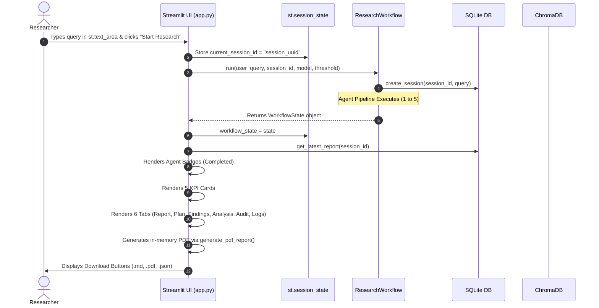

# 🖥️ Multi-Agent AI System: Comprehensive UI & Page-by-Page Workflow Specification

---

## 📌 নির্বাহী সারসংক্ষেপ (Executive Summary)

এই নথিতে **Multi-Agent AI Research & Analysis Assistant**-এর সম্পূর্ণ ইউজার ইন্টারফেস (`src/frontend/app.py`), প্রতিটি পেজ/ভিউ, সাইডবার কন্ট্রোলস, সমস্ত ইনপুট ফিল্ড এবং আউটপুট রেন্ডারিং মেকানিজম অত্যন্ত নিখুঁত ও বিস্তারিতভাবে বিশ্লেষণ করা হয়েছে।

প্রজেক্টটির ফ্রন্টএন্ড **Streamlit (v1.30+)** দ্বারা নির্মিত এবং এটি একটি রিঅ্যাক্টিভ (Reactive State-Driven) আর্কিটেকচার অনুসরণ করে। ব্যবহারকারীর ইনপুট নেওয়ার পর সিস্টেমটি ব্যাকএন্ডে **FastAPI**, **SQLite Memory Manager**, **ChromaDB Vector Store** এবং **OpenAI Agents SDK**-এর ৫-এজেন্ট পাইপলাইনের সাথে সরাসরি যোগাযোগ করে এবং ফলাফলগুলোকে ভিজ্যুয়াল কার্ড, কেপিআই (KPI), মাল্টি-ট্যাব এক্সপ্যান্ডার এবং ডাউনলোডেবল আর্কেভে রূপান্তর করে।

---

```mermaid
graph TD
    subgraph UI Navigation Controller (Sidebar)
        Nav[st.sidebar.radio 'Navigation']
        Key[OpenAI API Key Input]
        Config[Model / Scope / Gate Sliders]
    end

    Nav -->|View 1| P1[🔬 Research Studio<br/>Primary Research & Real-time Agents]
    Nav -->|View 2| P2[💬 Interactive Chat<br/>Conversational Memory & Follow-up]
    Nav -->|View 3| P3[📚 RAG Knowledge Base<br/>Document Ingestion & Semantic Query]
    Nav -->|View 4| P4[🗄️ Session History<br/>SQLite Archive & Session Vault]
    Nav -->|View 5| P5[📊 Evaluation & Benchmarks<br/>Latency & Token Auditing]

    P1 -->|Triggers| WF[ResearchWorkflow Engine]
    P2 -->|Queries| DB[(SQLite WAL Memory)]
    P3 -->|Embeds & Ingests| VDB[(ChromaDB Vector Store)]
    P4 -->|Retrieves Sessions| DB
    P5 -->|Profiles| Eval[AgentEvaluator Suite]
```

---

## 🛠️ সাইডবার কন্ট্রোলস (Global Sidebar Controls)

সাইডবারটি সমস্ত পেজের জন্য সর্বদা দৃশ্যমান এবং এটি গ্লোবাল সেটিংস নিয়ন্ত্রণ করে।

### ১. ভিজ্যুয়াল ওয়্যারফ্রেম (Sidebar ASCII Wireframe)
```
+---------------------------------------------+
| [AI Logo 64x64]                             |
| 🧠 System Control                           |
|---------------------------------------------|
| Navigation (Radio Options):                 |
|  (o) 🔬 Research Studio                     |
|  ( ) 💬 Interactive Chat                    |
|  ( ) 📚 RAG Knowledge Base                  |
|  ( ) 🗄️ Session History                     |
|  ( ) 📊 Evaluation & Benchmarks             |
|---------------------------------------------|
| 🔑 OpenAI API Configuration                 |
| [ Password Field: OpenAI API Key          ] |
| [🟢 Live OpenAI Mode / 🔵 Offline Mode]     |
|---------------------------------------------|
| ⚙️ Research Configuration                   |
| LLM Model:           [ gpt-4o-mini      v ] |
| Research Depth:      [====|============== ] |
| Quality Gate:        [========|========== ] |
| Max Revision Loops:  [============|====== ] |
+---------------------------------------------+
```

### ২. ইনপুট ফিল্ড ও উইজেট টেবিল (Sidebar Widgets Table)
| উইজেটের নাম (Widget Label) | উইজেট টাইপ (Streamlit Type) | ডিফল্ট মান (Default Value) | সংশ্লিষ্ট ভেরিয়েবল / স্টেট | উদ্দেশ্য ও আচরণ (Purpose & Execution Behavior) |
| :--- | :--- | :--- | :--- | :--- |
| **Navigation** | `st.radio` | `"🔬 Research Studio"` | `nav_selection` | ৫টি প্রধান পেজের মধ্যে ভিউ পরিবর্তন করে। স্টেট পরিবর্তনের সাথে সাথে পুরো পেজ রি-রেন্ডার হয়। |
| **OpenAI API Key (Optional)** | `st.text_input(type="password")` | `os.getenv("OPENAI_API_KEY")` | `user_api_key` | ইউজার তার নিজস্ব কী দিলে `os.environ["OPENAI_API_KEY"]` সেট হয় এবং লাইভ মোড চালু হয়। ফাঁকা থাকলে সিমুলেশন মোড সক্রিয় থাকে। |
| **LLM Model** | `st.selectbox` | `"gpt-4o-mini"` | `selected_model` | এজেন্টদের জন্য মডেল নির্বাচন করে (`gpt-4o-mini`, `gpt-4o`, `gpt-4-turbo`)। |
| **Research Depth** | `st.select_slider` | `"🔬 Standard Investigation"` | `research_scope` | গবেষণার পরিধি ও গভীরতা নির্ধারণ করে (`Executive Brief`, `Standard Investigation`, `Comprehensive Whitepaper`)। |
| **Quality Gate Threshold** | `st.slider` (0.50 to 0.95) | `0.70` | `verification_threshold` | ভেরিফিকেশন এজেন্টের ইন্টিগ্রিটি স্কোরের ন্যূনতম সীমা নির্ধারণ করে। এর নিচে স্কোর হলে রিভিশন লুপ ট্রিগার হয়। |
| **Max Revision Loops** | `st.slider` (1 to 3) | `2` | `max_iterations` | কোয়ালিটি গেট ফেইল করলে সুপারভাইজার সর্বাধিক কতবার পুনরায় রি-রিসার্চের নির্দেশ দিতে পারবে তা নিয়ন্ত্রণ করে। |

### ৩. আউটপুট ও প্রতিক্রিয়া (Sidebar Output Feedback)
- **API Status Pill:** ইউজার কী প্রদান করলে সবুজ রঙের `🟢 Live OpenAI Mode Active` ব্যানার রেন্ডার হয়; অন্যথায় নীল রঙের `🔵 Dynamic Offline Mode Active (Tailored to your query topic)` ব্যানার প্রদর্শিত হয়।

---

## 🔬 পেজ ১: Research Studio (প্রধান গবেষণা ওয়ার্কস্পেস)

### ১. পেজের ভিজ্যুয়াল ওয়্যারফ্রেম (Page Wireframe)
```
+-----------------------------------------------------------------------------------------+
| 🧠 Multi-Agent AI Research & Analysis Assistant                                         |
| Autonomous 5-Agent Collaborative Intelligence with Live Handoffs & Empirical Audits     |
|                                                                                         |
| [ Enter Research Topic or Objective... (st.text_area)          ] [🎯 Presets Dropdown ] |
|                                                                                         |
| [🚀 Start Multi-Agent Research (Button)]  Scope: Standard | Model: 4o-mini | Gate: 0.70 |
|-----------------------------------------------------------------------------------------|
| 🤖 Specialized Agent Team Pipeline (Status Cards)                                       |
| +-------------+ +-------------+ +-------------+ +-------------+ +-------------+         |
| | 👑 Superv.  | | 🔬 Research | | 📊 Analysis | | 🛡️ Verif.   | | 📑 Report   |         |
| | Plan & Dec. | | Web & RAG   | | Insights    | | QualityGate | | Final Report|         |
| | [ Ready ]   | | [ Ready ]   | | [ Ready ]   | | [ Ready ]   | | [ Ready ]   |         |
| +-------------+ +-------------+ +-------------+ +-------------+ +-------------+         |
|-----------------------------------------------------------------------------------------|
| 📈 KPI Summary Cards (Post-Execution)                                                   |
| [ Domain ] [ Complexity ] [ Data Integrity: 94% ] [ Citations: 5 ] [ Status: COMPLETED ]|
|-----------------------------------------------------------------------------------------|
| 📑 Research Pipeline Artifacts (st.tabs)                                                |
| [ Final Report ] [ Supervisor Plan ] [ Findings ] [ Deep Analysis ] [ Audit ] [ Logs ]  |
|                                                                                         |
| - Title & Executive Summary Box (Callout)                                               |
| - Topical Section Headings & Paragraphs                                                 |
| - Quantitative Comparison Tables (Accuracy, Precision, Recall, F1, ROC-AUC)             |
| - Key Takeaways (Bullets) & Conclusion                                                  |
| - References List                                                                       |
|                                                                                         |
| [📥 Download (.md)]       [📄 Download (.pdf)]       [📊 Download (.json)]              |
+-----------------------------------------------------------------------------------------+
```

### ২. ইনপুট উইজেটস ও স্টেট ম্যাপিং (Input Widgets & State Mapping)
1. **🎯 Presets (`st.selectbox`):**
   - **অবস্থান:** ইনপুট ফিল্ডের ডানপাশে (`col_sample`)।
   - **অপশনস:** `"Custom Query"` এবং ৭টি সুনির্দিষ্ট প্রিসেট (Heart Disease ML/DL, AI Healthcare, Solid-state Batteries, Post-Quantum Cryptography, CRISPR, ইত্যাদি)।
   - **আচরণ:** কোনো প্রিসেট নির্বাচন করলে স্বয়ংক্রিয়ভাবে পাশের টেক্সট এরিয়া সেই প্রিসেটের টেক্সট দিয়ে পূর্ণ হয়ে যায়।
2. **Enter Research Topic or Objective (`st.text_area`):**
   - **কী / ভ্যারিয়েবল:** `user_query` (উচ্চতা: ৮৫ পিক্সেল)।
   - **প্লেসহোল্ডার:** `"e.g., Analyze the economic impact of agricultural drones..."`
   - **আচরণ:** ব্যবহারকারীর কাস্টম প্রশ্ন বা নির্বাচিত প্রিসেট ধারণ করে।
3. **🚀 Start Multi-Agent Research (`st.button`):**
   - **টাইপ:** Primary CTA Button (`use_container_width=True`)।
   - **ট্রিগার ইভেন্ট:**
     - ফাঁকা কোয়েরি থাকলে `st.warning("Please specify a research topic.")` দেখায়।
     - কোয়েরি থাকলে একটি নতুন ইউনিক `session_id` (`session_uuid[:8]`) জেনারেট করে।
     - `st.progress` বার ইনিশিয়ালাইজ করে (০% থেকে ১০০% পর্যন্ত ৫টি ধাপে আপডেট হয়)।
     - `evaluator.evaluate_workflow()` বা `ResearchWorkflow.run()` অ্যাসিনক্রোনাসলি কল করে।
     - রেজাল্টকে `st.session_state.workflow_state` এবং `st.session_state.eval_report`-এ সংরক্ষণ করে।

### ৩. আউটপুট ডিসপ্লে মেকানিজম (Output Display Components)

#### ক. ৫টি এজেন্টের লাইভ স্ট্যাটাস কার্ড (Agent Status Cards):
- HTML/CSS কাস্টম ক্লাস `.agent-card` দিয়ে ৫টি কলামে রেন্ডার হয়।
- পাইপলাইন শেষ হওয়ার আগে ব্যাজ থাকে `Ready` (`.badge-ready` - হালকা নীল)।
- পাইপলাইন সফলভাবে শেষ হলে সব ব্যাজ হয়ে যায় `Completed` (`.badge-done` - সবুজ)।

#### খ. কেপিআই সামারি কার্ডস (KPI Metric Header):
গবেষণা সম্পন্ন হলে ৫টি মূল মেট্রিক কার্ড দৃশ্যমান হয়:
1. **Research Domain:** গবেষণার ক্ষেত্র (যেমন: *Healthcare / Cardiovascular Cardiology*)।
2. **Complexity Level:** জটিলতার মাত্রা (যেমন: *HIGH*)।
3. **Data Integrity Score:** ভেরিফিকেশন এজেন্টের সামগ্রিক সততা স্কোর (যেমন: `94%`, সবুজ রঙে রেন্ডারকৃত)।
4. **Primary Citations:** রিপোর্টে উল্লেখিত মূল রেফারেন্স পেপারের সংখ্যা।
5. **Pipeline Status:** পাইপলাইনের চূড়ান্ত অবস্থা (`COMPLETED`)।

#### গ. ৬টি মাল্টি-ট্যাব আর্টিফ্যাক্ট ভিউয়ার (`st.tabs`):
1. **📑 Final Report Tab:**
   - **Title:** `<h2>` হেডিং আকারে প্রদর্শিত।
   - **Executive Summary:** `.exec-summary-box` কাস্টম স্টাইলে হালকা নীল ব্যাকগ্রাউন্ড এবং নীল বর্ডার দিয়ে হাইলাইট করা সামারি।
   - **Topical Sections:** প্রতিটি সেকশনের শিরোনাম এবং প্যারাগ্রাফ।
   - **Strategic Key Takeaways:** বুলেট পয়েন্টে গুরুত্বপূর্ণ সিদ্ধান্তসমূহ।
   - **Conclusion & References:** রেফারেন্স পেপারের তালিকা।
   - **ডাউনলোড বাটন ট্রায়ো:**
     - `📥 Download Report (.md)`: সম্পূর্ণ ফরম্যাট করা মার্কডাউন ফাইল।
     - `📄 Download Report (.pdf)`: **ReportLab** দিয়ে রিয়েল-টাইমে জেনারেট করা প্রিন্টেবল ও স্টাইলিশ একাডেমিক পিডিএফ।
     - `📊 Download Data (.json)`: সম্পূর্ণ Pydantic ডেটা ডাম্প।
2. **📋 Supervisor Plan Tab:**
   - সুপারভাইজারের তৈরি করা ডোমেন, অবজেক্টিভস (১, ২, ৩...), এবং ৪টি ভিন্ন রঙের ইনফো বক্সে বাকি ৪ এজেন্টের দায়িত্ব বণ্টন কৌশল (`delegation_strategy`)।
3. **🔬 Research Findings Tab:**
   - রিসার্চ ওভারভিউ, প্রাপ্ত তথ্যসমূহ (🔬), পর্যবেক্ষিত ট্রেন্ডসমূহ (📈), অমীমাংসিত প্রশ্নসমূহ (❓) এবং সোর্স লিঙ্ক (🔗)।
4. **📊 Deep Analysis Tab:**
   - **Quantitative Model & Algorithmic Comparisons:** প্রতিটি অ্যালগরিদমের জন্য আলাদা এক্সপ্যান্ডার। ভিতরে ৫টি কলামে Accuracy, Precision, Recall, F1-Score, ROC-AUC মেট্রিক্স কার্ড এবং ডেটাসেটের বৈশিষ্ট্য ও সীমাবদ্ধতা প্রদর্শিত হয়।
   - থিম্যাটিক প্যাটার্ন (🧩), পরস্পরবিরোধী মতামত (⚖️), কৌশলগত সুযোগ (🚀) এবং সিস্টেমিক ঝুঁকি (⚠️)।
5. **🛡️ Verification Audit Tab:**
   - সামগ্রিক অডিট রায় (`Audit Verdict`) এবং কনফিডেন্স স্কোর প্রগ্রেস বার।
   - **Claim-by-Claim Verification:** প্রতিটি দাবির জন্য আলাদা ড্রপডাউন এক্সপ্যান্ডার। স্ট্যাটাস যদি `VERIFIED` হয় তবে সবুজ ব্যাজ, অন্যথায় অ্যাম্বার রঙের `UNSUPPORTED` ব্যাজ, সাথে সোর্স কোটেশন ও এভিডেন্স নোট।
6. **📜 Execution Logs Tab:**
   - প্রতিটি এজেন্টের টাইমস্ট্যাম্পসহ অভ্যন্তরীণ লগ Bash কোড ব্লকে দেখা যায়।

---

## 💬 পেজ ২: Interactive Chat (ইন্টারেক্টিভ এআই চ্যাট)

### ১. পেজের ভিজ্যুয়াল ওয়্যারফ্রেম (Page Wireframe)
```
+-----------------------------------------------------------------------------------------+
| 💬 Multi-Agent Research Chat                                                            |
| Collaborate with the specialized agent team in a persistent conversational thread       |
|                                                                                         |
| Active Session ID: session_a1b2c3d4 | Backed by SQLite Memory      [🧹 Clear Chat (btn)]|
|-----------------------------------------------------------------------------------------|
| [👤 User Avatar]: What are the primary dataset limitations mentioned in the report?     |
|                                                                                         |
| [🤖 Assistant Avatar - Analysis Agent]:                                                 |
| Based on the empirical findings, the primary limitations stem from cohort imbalance...  |
| - Accuracy: 94.2% across MIT-BIH Arrhythmia Database                                    |
| - Limitation: Lack of multi-ethnic external validation cohorts                          |
| Integrity Score: 92%                                                                    |
|-----------------------------------------------------------------------------------------|
| [ Ask a research question or request follow-up analysis... (st.chat_input)          ] |
+-----------------------------------------------------------------------------------------+
```

### ২. ইনপুট উইজেটস ও স্টেট ট্র্যাকিং (Input Widgets)
| উইজেট (Widget) | উইজেট টাইপ | প্যারামিটার / স্টেট | ব্যাকএন্ড মেকানিজম |
| :--- | :--- | :--- | :--- |
| **🧹 Clear Chat History** | `st.button` | `st.session_state.chat_messages = []` | সেশনের চ্যাট মেমরি রিসেট করে এবং `st.rerun()` কল করে স্ক্রিন রিফ্রেশ করে। |
| **Chat Input** | `st.chat_input` | `"Ask a research question..."` | ইউজারের প্রম্পট গ্রহণ করে, অবিলম্বে ইউজার বাবলে দেখায় এবং SQLite ডেটাবেজে মেসেজটি ইনসার্ট করে। |

### ৩. আউটপুট রেন্ডারিং (Output Rendering)
- **`st.chat_message("user")`:** ব্যবহারকারীর বার্তা ডানপাশে ইউজার অ্যাভাটারসহ প্রদর্শিত হয়।
- **`st.chat_message("assistant")`:**
  - `st.spinner("Specialized agents deliberating...")` লোডার চলে।
  - মেমরি ম্যানেজার থেকে পূর্ববর্তী কনটেক্সট নিয়ে `ResearchWorkflow` রান হয়।
  - অ্যাসিস্ট্যান্ট এজেন্টের নাম (যেমন: *Analysis Agent* বা *Supervisor*), রিপোর্টের সারসংক্ষেপ এবং ইন্টিগ্রিটি স্কোর প্রদর্শিত হয়।

---

## 📚 পেজ ৩: RAG Knowledge Base (ডকুমেন্ট ইনজেশন ও সেমান্টিক কুয়েরি)

### ১. পেজের ভিজ্যুয়াল ওয়্যারফ্রেম (Page Wireframe)
```
+-----------------------------------------------------------------------------------------+
| 📚 RAG Vector Knowledge Base Explorer                                                   |
| Inspect, ingest, and semantically query institutional technical documents in ChromaDB   |
|                                                                                         |
| [ Ingest Technical Documents (Tab 1) ]       [ Semantic Vector Query (Tab 2) ]          |
|-----------------------------------------------------------------------------------------|
| (TAB 1 CONTENT)                                                                         |
| 📂 Upload Local Document: [ Browse Files (.txt, .md) ]                                  |
| [ Source Name: Uploaded_Document.md ]  [ Category Dropdown: clinical_research         ] |
|                                                                                         |
| Technical Literature Text Area:                                                         |
| [ Field clinical trials across Sub-Saharan Africa evaluated edge-quantized networks... ]|
|                                                                                         |
| [📥 Chunk & Ingest into ChromaDB (Primary Button)]                                      |
| -> Output: "✅ Successfully chunked and indexed 8 passages into ChromaDB!"              |
|-----------------------------------------------------------------------------------------|
| (TAB 2 CONTENT)                                                                         |
| Semantic Query: [ What is the diagnostic accuracy of mobile malaria triage?           ] |
| Top K Matches:  [===|=====] (Slider: 1 to 6, Default: 3)                                |
| [🔎 Run Semantic Vector Search (Button)]                                                |
|                                                                                         |
| [v] [1] WHO_Malaria_Report.pdf (Cosine Relevance: 0.89)                                 |
|     [======================================] 89% Relevance                              |
|     "Clinical sensitivity reached 94.8% with a 6-minute latency..."                     |
+-----------------------------------------------------------------------------------------+
```

### ২. ইনপুট উইজেটস ও স্টেট ম্যাপিং
- **ট্যাব ১ (Ingest Technical Documents):**
  1. `st.file_uploader`: `.txt` ও `.md` ফাইল আপলোড সাপোর্ট করে। ফাইল আপলোড হলে টেক্সট স্বয়ংক্রিয়ভাবে টেক্সট এরিয়াতে লোড হয়।
  2. `st.text_input ("Source Document Name / Citation")`: ফাইলের নাম বা জার্নাল সাইটেশন।
  3. `st.selectbox ("Category")`: ক্যাটাগরি ফিল্টারিং (`clinical_research`, `infrastructure`, `policy`, `ethics`, `general_technical`)।
  4. `st.text_area ("Paste Technical Literature")`: ড্রাফট টেক্সট ইনপুট এরিয়া।
  5. `st.button ("📥 Chunk & Ingest into ChromaDB")`:
     - `retriever.ingest_document()` মেথড কল করে।
     - টেক্সটকে চাঙ্ক করে, ভেক্টর এম্বেডিং তৈরি করে ChromaDB-তে পারসিস্ট করে।
     - সফল হলে সবুজ রঙের সাকসেস মেসেজ ও ইনডেক্স হওয়া চাঙ্ক সংখ্যা দেখায়।
- **ট্যাব ২ (Semantic Vector Query):**
  1. `st.text_input ("Semantic Query")`: ব্যবহারকারীর সেমান্টিক অনুসন্ধানের প্রশ্ন।
  2. `st.slider ("Top K Matches")`: কতটি প্রাসঙ্গিক প্যাসেজ রিট্রিভ করতে হবে (১ থেকে ৬, ডিফল্ট ৩)।
  3. `st.button ("🔎 Run Semantic Vector Search")`:
     - `retriever.retrieve(query, top_k)` কল করে কোসাইন দূরত্বের ভিত্তিতে সবচেয়ে প্রাসঙ্গিক চাঙ্কগুলো নিয়ে আসে।
     - প্রতিটি চাঙ্কের জন্য এক্সপ্যান্ডার, কোসাইন রিলেভেন্স প্রগ্রেস বার এবং প্যাসেজ টেক্সট প্রদর্শন করে।

---

## 🗄️ পেজ ৪: Session History (পূর্ববর্তী গবেষণার আর্কাইভ ও মেমরি ভল্ট)

### ১. পেজের ভিজ্যুয়াল ওয়্যারফ্রেম (Page Wireframe)
```
+-----------------------------------------------------------------------------------------+
| 🗄️ Research Session History & Memory Vault                                              |
| Inspect historical research sessions, persistent facts, constraints, and audit trails   |
|                                                                                         |
| Total Recorded Sessions: 4                                                              |
| 🔍 Filter Sessions by Keyword / Title: [ heart disease                                ] |
|-----------------------------------------------------------------------------------------|
| [v] Session: ML Heart Disease Detection (COMPLETED) - ID: session_9f8a12bc              |
|     +----------------+----------------+----------------+----------------+               |
|     | Messages: 6    | Memories: 12   | Report: Yes    | Updated: 23:45 |               |
|     +----------------+----------------+----------------+----------------+               |
|     Executive Summary:                                                                  |
|     "Comparative evaluation of XGBoost and 1D-CNN on electrocardiogram signals..."     |
|     [ Activate Session (Button) ]                                                       |
|                                                                                         |
|     Recent Message Traces:                                                              |
|     [user|None]: Analyze early detection algorithms...                                  |
|     [assistant|Supervisor]: Research plan formulated with 3 parallel subtasks...         |
+-----------------------------------------------------------------------------------------+
```

### ২. ইনপুট উইজেটস ও ফিল্টারিং
- **`st.text_input ("🔍 Filter Sessions by Keyword / Title")`:**
  - ব্যবহারকারী কোনো কি-ওয়ার্ড লিখলে সাথে সাথে সেশন টাইটেল ফিল্টার হয় (`[s for s in sessions if search_filter.lower() in s.title.lower()]`)।
- **`st.button ("Activate Session")`:**
  - নির্দিষ্ট সেশনের আইডিতে ক্লিক করলে `st.session_state.current_session_id = s.session_id` সেট হয় এবং ওই সেশনের পুরনো রিপোর্ট ও চ্যাট মেমরি কারেন্ট ওয়ার্কস্পেসে লোড হয়ে যায়।

### ৩. আউটপুট ডিসপ্লে
- **সেশন মেট্রিক্স কার্ডস:** ৪টি মেট্রিক কলামে মোট মেসেজ সংখ্যা, পারসিস্টেন্ট মেমরি ফ্যাক্টস, রিপোর্ট তৈরি হয়েছে কিনা (`Yes`/`No`) এবং লাস্ট আপডেট টাইমস্ট্যাম্প দেখা যায়।
- **Executive Summary & Traces:** সংরক্ষিত রিপোর্টের সারসংক্ষেপ এবং সাম্প্রতিক ইন্টার-এজেন্ট মেসেজ ট্রেস প্রিভিউ।

---

## 📊 পেজ ৫: Evaluation & Benchmarks (পারফরম্যান্স ও অডিট বেঞ্চমার্ক)

### ১. পেজের ভিজ্যুয়াল ওয়্যারফ্রেম (Page Wireframe)
```
+-----------------------------------------------------------------------------------------+
| 📊 Multi-Agent Evaluation & Performance Benchmarks                                      |
| Quantitative AI Evaluation: Latency Profiling, Token Consumption & Schema Completeness  |
|                                                                                         |
| [ 🧪 Single Workflow Evaluator (Tab 1) ]     [ ⚡ Multi-Domain Benchmark Suite (Tab 2) ]  |
|-----------------------------------------------------------------------------------------|
| (TAB 1 CONTENT)                                                                         |
| Evaluation Topic: [ Autonomous driving safety standards in North America and the EU.  ] |
| [🚀 Run Evaluation Audit (Primary Button)]                                               |
|                                                                                         |
| Evaluation Metrics:                                                                     |
| [ Latency: 1.24s ] [ In Tokens: 1,420 ] [ Out Tokens: 950 ] [ Schema: 100% ] [PASSED]   |
|                                                                                         |
| Agent Schema Conformance Audit:                                                         |
| - Supervisor Agent      ........................................ [ 100% Valid (Badge) ] |
| - Research Agent        ........................................ [ 100% Valid (Badge) ] |
| - Analysis Agent        ........................................ [ 100% Valid (Badge) ] |
| - Verification Agent    ........................................ [ 100% Valid (Badge) ] |
| - Report Agent          ........................................ [ 100% Valid (Badge) ] |
|                                                                                         |
| Automated Recommendations:                                                              |
| [💡 Pipeline operating at optimal latency with complete schema conformance.           ] |
|-----------------------------------------------------------------------------------------|
| (TAB 2 CONTENT)                                                                         |
| Multi-Topic Battery: Runs 3 diverse domain queries (Crypto, Clean Energy, Healthcare)    |
| [⚡ Run 3-Topic Benchmark Battery (Primary Button)]                                      |
|                                                                                         |
| Aggregated Benchmark Results:                                                           |
| [ Success: 100% ] [ Mean Latency: 1.18s ] [ Mean Integrity: 0.93 ] [ Total Tokens: 7.2k]|
+-----------------------------------------------------------------------------------------+
```

### ২. ইনপুট উইজেটস
- **ট্যাব ১ (Single Workflow Evaluator):**
  - `st.text_input ("Evaluation Topic")`: পরীক্ষামূলক গবেষণার বিষয়।
  - `st.button ("🚀 Run Evaluation Audit")`: সিঙ্গেল রান ইভালুয়েশন শুরু করে।
- **ট্যাব ২ (Multi-Domain Benchmark Suite):**
  - `st.button ("⚡ Run 3-Topic Benchmark Battery")`: একসাথে ৩টি ভিন্ন জটিল ডোমেন (কোয়ান্টাম ক্রিপ্টোগ্রাফি, সোলার সেলস, মোবাইল এআই হেলথকেয়ার) নিয়ে পাইপলাইনের স্ট্রেস-টেস্ট পরিচালনা করে।

### ৩. আউটপুট ও মেট্রিক্স ডিসপ্লে
- **একক রান অডিট রেজাল্ট:**
  - ৫টি কেপিআই মেট্রিক্স: টোটাল লেটেন্সি (সেকেন্ড), আনুমানিক ইনপুট টোকেন, আউটপুট টোকেন, স্কিমা কনফরম্যান্স স্কোর (`100.0%`), এবং কোয়ালিটি গেট ফলাফল (`PASSED` বা `FAILED`)।
  - **Schema Conformance Table:** প্রতিটি এজেন্টের জন্য আলাদা ভ্যালিডেশন ব্যাজ (`100% Valid`)।
  - **Automated Recommendations:** সিস্টেমের এআই সুপারিশমালা (`st.info` বক্সে)।
- **মাল্টি-টপিক ব্যাটারি রেজাল্ট:**
  - ৪টি সমন্বিত মেট্রিক্স: ওভারঅল সাকসেস রেট (`100%`), গড় রেসপন্স টাইম (Mean Latency), গড় ইন্টিগ্রিটি স্কোর (Mean Integrity), এবং মোট খরচ হওয়া টোকেন সংখ্যা।

---

## 🔄 ডেটা ফ্লো ও স্টেট ট্রানজিশন ডায়াগ্রাম (End-to-End Data Flow)



---
*Authored by Md. Zobayer Chowdhury for the Autonomous Multi-Agent AI System Project.*
